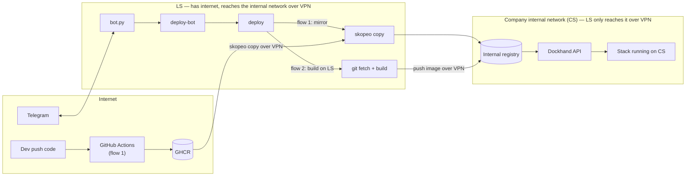

# local-server-bot

Automated deploy system for internal apps: build the image, push it into an internal registry, redeploy the stack on Dockhand, and control/report results through Telegram.

This README has two parts: **[For users](#for-users)** — install, configure, and run it, never touching the source — and **[For developers](#for-developers)** — how it's built, and how to work on it.

---

# For users

## Terms

| Name | What it is |
|---|---|
| **LS** | A Linux machine with systemd (a server, an Ubuntu PC, or WSL2 on Windows) with unrestricted internet access and a path to CS over VPN/LAN. Runs the bot, builds, and mirrors. |
| **CS** | The UAT server on a private network. Restricted internet access from abroad. Runs the registry and Dockhand. |
| **GHCR** | GitHub Container Registry, where CI pushes images in flow 1. |
| **Dockhand** | A docker compose management tool on CS, called via its API. |
| **Bot** | The main bot (takes commands in the group) and a CI bot (used by CI to report/trigger deploys) — two separate Telegram bots, named whatever you like when you create them. |

## 1. Install

No cloning needed — just download and run. This step only installs the code and its dependencies (git, skopeo, jq, python3, the scripts, the bot's venv); it does **not** generate any config or start anything yet.

```bash
# Linux
curl -fsSL https://raw.githubusercontent.com/alexnguyen03/local-server-bot/main/install.sh | sudo bash
```

```powershell
# Windows (PowerShell) — sets up WSL if needed, then runs the same install inside it
irm https://raw.githubusercontent.com/alexnguyen03/local-server-bot/main/install.ps1 | iex
```

On Windows, everything after this step runs **inside a WSL shell** (`wsl` from PowerShell, or the Ubuntu app), not PowerShell — `lsb`, `curl`, systemd etc. all live there.

## 2. Set up (`lsb init`)

```bash
sudo lsb init
```

This generates, from the samples, everything the install step didn't touch: `ops/structure.json` (which services exist), `bot.allow`, a `service.env` stub per service, and the bot's `.env` stub. It's an upsert — safe to run again any time you add a service, and it never overwrites files you've already filled in.

Then fill in by hand:
- `/devops/bot/.env` — `BOT_TOKEN`, `ALLOWED_CHAT_ID` (get it via `/id` in the Telegram group once the bot is running), `ALLOWED_USER_IDS`.
- Each `service.env` it created — `GH_REPO`/`APP`/`DOCKHAND_STACK` at minimum.
- `common.env` and `.secrets` per environment — these two aren't generated for you, see [examples/](examples) and run `lsb init` again afterwards if you want — it'll just confirm nothing's missing.

Run `lsb doctor` any time to check what's still missing.

### Using a root directory other than `/devops`

1. Run `sudo lsb install` (or the one-liner) once — it creates `ops/install.conf` from the sample under `/devops/_src/ops/`.
2. Edit `DEVOPS_ROOT` in that file to the path you want (e.g. `/opt/mybot`) **before** running `init`/`start` — do this before anything is actually running, not after.
3. Run `sudo lsb init` and `sudo lsb start` as usual. They read your edited `install.conf` first and never overwrite it, so the custom root sticks across every later `lsb install`/`init`/`start`.

Changing `DEVOPS_ROOT` after a root is already fully running does **not** move anything — it starts a second, separate install at the new root, and whatever was already running at the old root keeps running there untouched.

## 3. Start / stop

```bash
sudo lsb start   # installs the systemd service if needed, then starts it
sudo lsb stop    # stops it (starts again on the next reboot unless you also `systemctl disable deploy-bot`)
```

Once started, type `/ping` in the Telegram group to check — the bot also posts "Bot online" there by itself.

## 4. Day to day

```bash
lsb deploy <env> <project> [force] [dry] [tag]   # same as running deploy directly
lsb status [env]                                 # what's currently deployed
lsb doctor [env]                                 # what's missing/set in each service.env
lsb install                                      # re-fetch the latest release and update the code (run from anywhere)
```

Most of this also works as Telegram commands once the bot is running (`/status_uat`, `/doctor_uat`, `/deploy_<project>_<env>`, ...) — see the example below and [docs/OPERATIONS.md](docs/OPERATIONS.md) for the full list, troubleshooting, and adding a coworker.

**Network note:** CS sits on a private company network. LS reaches it over **VPN** — if the VPN drops, the bot stays alive (still takes Telegram commands) but deploys fail until it's back. See [ADR-0001](docs/adr/0001.md) for why it's built this way.

## Example: structure.json → what you get

`ops/structure.json` is the only thing you edit to add/remove services — everything else (folders, `bot.allow`, Telegram commands) is generated from it by `lsb init`. For example, this file with 4 services (2 in `uat`, 2 in `prod`):

```json
{
  "services": [
    { "env": "uat",  "project": "payments-api", "auto": true, "dry": true },
    { "env": "uat",  "project": "webadmin",      "auto": true },
    { "env": "prod", "project": "payments-api",  "auto": false },
    { "env": "prod", "project": "webadmin",       "auto": false }
  ]
}
```

...produces this on LS (everything here is created regardless of how many services you have, except the `uat/`/`prod/` folders — one per distinct `env` in `structure.json`):

```
/devops
├── bin/                   deploy, deploy-bot, deploy-core.sh, build-local, resolve-tag.sh, lsb   (install)
├── bot/                   bot.py, .venv/, .env (your BOT_TOKEN etc.)                              (install + init)
├── bot.allow              <- generated from structure.json, see its content below                (init)
├── structure.json         <- a copy of ops/structure.json                                         (init)
├── uat/
│   ├── common.env         <- you create this yourself, see examples/common.env
│   ├── .secrets           <- you create this yourself, see examples/secrets.example
│   ├── payments-api/service.env   (stub with CHANGEME — fill it in)
│   └── webadmin/service.env       (stub with CHANGEME — fill it in)
└── prod/
    ├── common.env, .secrets       (same as uat/, your own separate prod credentials)
    ├── payments-api/service.env   (stub with CHANGEME — fill it in)
    └── webadmin/service.env       (stub with CHANGEME — fill it in)
```

`bot.allow` is a plain text **file**, not a folder — its content is just the `env/project` pairs, one per line:

```
uat/payments-api
uat/webadmin
prod/payments-api
prod/webadmin
```

...and these Telegram commands (`/help`), active once `lsb start` is running:

```
/devops
└─ uat   /status_uat  /doctor_uat
   payments-api   /deploy_payments_api_uat  /redeploy_payments_api_uat (force)  /dry_payments_api_uat (dry run)
   webadmin       /deploy_webadmin_uat      /redeploy_webadmin_uat (force)
└─ prod  /status_prod  /doctor_prod
   payments-api   /deploy_payments_api_prod  /redeploy_payments_api_prod (force)
   webadmin       /deploy_webadmin_prod      /redeploy_webadmin_prod (force)
```

Only `payments-api`/`uat` has `/dry_payments_api_uat`, because `"dry": true` was only set on that one block — add it to another block to get a dry-run command there too. Auto-deploy defaults to every service with `"auto": true` (here: `deploy_payments_api_uat,deploy_webadmin_uat`), overridable per-bot in `.env`'s `AUTO_DEPLOY` without reinstalling.

## Read next

1. [docs/OPERATIONS.md](docs/OPERATIONS.md): day-to-day operation and troubleshooting.
2. [docs/adr/](docs/adr/): why it's designed this way, what alternatives were ruled out.

---

# For developers

## Architecture



CS has no outbound internet and nothing from outside can call into it either; LS is the only machine with both internet access and a VPN path in. See [docs/adr/](docs/adr/) for the full set of design decisions and what was ruled out.

## Release pipeline

`.github/workflows/release.yml` runs on every push to `main`: syntax-checks every script in `src/bin/*` and `bot.py`, packages `src/`, `ops/`, `examples/` into a tarball, and publishes it as a rolling `latest` GitHub Release (tag and release both get recreated each time, so it always tracks `main`'s current HEAD). `install.sh`/`install.ps1`/`lsb install` all fetch that same tarball.

## Working from a local checkout

```bash
git clone https://github.com/alexnguyen03/local-server-bot.git && cd local-server-bot
sudo bash ops/install.sh install    # or: install.cmd on Windows, runs the same thing inside WSL
sudo bash ops/install.sh init
sudo bash ops/install.sh start
```

Useful when testing a change before it's merged to `main` (the one-liners always pull from the published release, not your working tree).

## Directory layout

```
src/bot/bot.py          Telegram bot (python-telegram-bot, long polling)
src/bin/deploy          deploy entry point (resolve tag, build locally or mirror, call the core)
src/bin/deploy-core.sh  mirror/verify, update the Dockhand stack, health check, rollback, image cleanup
src/bin/deploy-bot      the safe gateway between the bot and deploy (allowlist, syntax checks)
src/bin/build-local     build on LS (Jib or Docker) and push straight to CS
src/bin/resolve-tag.sh  find the latest tag on GHCR (flow 1)
src/bin/lsb             CLI wrapper (install/init/start/stop/deploy/status/doctor), installed onto PATH
examples/               sample config (no real secrets)
ops/install.sh          install|init|start|stop — the real installer, called by every entry point below
ops/install-service.sh  systemd unit install, called by 'start'
ops/                    + the systemd unit file, structure.json/install.conf samples, ops/wsl/ for Windows
install.sh              Linux/WSL one-liner (curl | bash): fetches the latest release, runs 'install'
install.ps1             Windows one-liner (irm | iex): sets up WSL if needed, then runs install.sh inside it
install.cmd, ops/wsl/   same thing, but for running from a local checkout instead of the one-liner
.github/workflows/      CI: syntax-checks scripts and publishes the rolling "latest" release
```

Files under `src/bin` get installed to `/devops/bin` on LS; `bot.py` runs from `/devops/bot/`.

## Status

Both flow 1 (GHCR) and flow 2 (build on LS) have run for real on an internal deployment before this was split out into a template.
