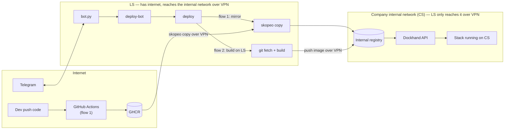

# local-server-bot

Automated deploy system for internal apps: build the image, push it into an internal registry, redeploy the stack on Dockhand, and control/report results through Telegram.

## Terms

| Name | What it is |
|---|---|
| **LS** | A Linux machine with systemd (a server, an Ubuntu PC, or WSL2 on Windows) with unrestricted internet access and a path to CS over VPN/LAN. Runs the bot, builds, and mirrors. |
| **CS** | The UAT server on a private network. Restricted internet access from abroad. Runs the registry and Dockhand. |
| **GHCR** | GitHub Container Registry, where CI pushes images in flow 1. |
| **Dockhand** | A docker compose management tool on CS, called via its API. |
| **Bot** | The main bot (takes commands in the group) and a CI bot (used by CI to report/trigger deploys) — two separate Telegram bots, named whatever you like when you create them. |

## Architecture



**Network note:** CS sits on the company's internal network, has no outbound internet access, and nothing from outside can call into it either. LS is the only machine with both internet access and a path into that network — over **VPN**. Every mirror/push and every Dockhand call from LS goes through this VPN; if the VPN drops, the bot stays alive (still receives Telegram commands) but deploys will fail since it can't reach CS. See [ADR-0001](docs/adr/0001.md).

## Quickstart

On LS (a Linux machine with systemd, or a Windows PC with WSL2):

```bash
# Linux
git clone <repo-url> && cd local-server-bot
sudo bash ops/install.sh

# Windows (runs inside WSL)
git clone <repo-url> && cd local-server-bot
install.cmd
```

Run the same command again whenever the script tells you something is missing — on the first run it creates `ops/structure.json` and `/devops/bot/.env` from the samples and stops so you can fill in `BOT_TOKEN`/`ALLOWED_CHAT_ID` (get it via `/id` in the group) and `GH_REPO`/`APP`/`DOCKHAND_STACK` in each service's `service.env`. Safe to run repeatedly (it's an upsert) — it never overwrites config/secrets you've already filled in. Once it's done, type `/ping` in the Telegram group to check. Details: [docs/OPERATIONS.md](docs/OPERATIONS.md).

## Read in this order

1. [docs/adr/](docs/adr/): why it's designed this way, what alternatives were ruled out.
2. [docs/OPERATIONS.md](docs/OPERATIONS.md): setup, day-to-day operation, troubleshooting.

## Directory layout

```
src/bot/bot.py          Telegram bot (python-telegram-bot, long polling)
src/bin/deploy          deploy entry point (resolve tag, build locally or mirror, call the core)
src/bin/deploy-core.sh  mirror/verify, update the Dockhand stack, health check, rollback, image cleanup
src/bin/deploy-bot      the safe gateway between the bot and deploy (allowlist, syntax checks)
src/bin/build-local     build on LS (Jib or Docker) and push straight to CS
src/bin/resolve-tag.sh  find the latest tag on GHCR (flow 1)
examples/               sample config (no real secrets)
ops/                    installer + systemd service so the bot restarts itself after a crash or reboot (ops/wsl/ for Windows)
install.cmd             Windows: install/update LS inside WSL with one command
```

Files under `src/bin` get installed to `/devops/bin` on LS; `bot.py` runs from `/devops/bot/`.

## Status

Both flow 1 (GHCR) and flow 2 (build on LS) have run for real on an internal deployment before this was split out into a template.
