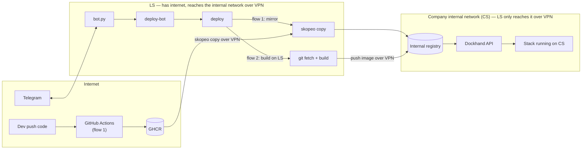

# local-server-bot

Automated deploy system for internal apps: build the image, push it into an internal registry, redeploy the stack on Dockhand, and control/report results through Telegram.

## Terms

| Name | What it is |
|---|---|
| **LS** | A Linux machine with systemd (a server, an Ubuntu PC, or WSL2 on Windows) with unrestricted internet access and a path to CS over VPN/LAN. Runs the bot, builds, and mirrors. |
| **CS** | The UAT server on a private network. Restricted internet access from abroad. Runs the registry and Dockhand. |
| **GHCR** | GitHub Container Registry, where CI pushes images in flow 1. |
| **Dockhand** | A docker compose management tool on CS, called via its API. |
| **Bot** | The main bot (takes commands in the group) and a CI bot (used by CI to report/trigger deploys) — two separate Telegram bots, named whatever you like when you create them. |

## Architecture



**Network note:** CS sits on the company's internal network, has no outbound internet access, and nothing from outside can call into it either. LS is the only machine with both internet access and a path into that network — over **VPN**. Every mirror/push and every Dockhand call from LS goes through this VPN; if the VPN drops, the bot stays alive (still receives Telegram commands) but deploys will fail since it can't reach CS. See [ADR-0001](docs/adr/0001.md).

## Quickstart

No cloning needed either way — just download and run. On LS (a Linux machine with systemd, or a Windows PC with WSL2):

```bash
# Linux
curl -fsSL https://raw.githubusercontent.com/alexnguyen03/local-server-bot/main/install.sh | sudo bash
```

```powershell
# Windows (PowerShell) — sets up WSL if needed, then runs the same install inside it
irm https://raw.githubusercontent.com/alexnguyen03/local-server-bot/main/install.ps1 | iex
```

Run the same command again whenever the script tells you something is missing — on the first run it creates `ops/structure.json` and `/devops/bot/.env` from the samples and stops so you can fill in `BOT_TOKEN`/`ALLOWED_CHAT_ID` (get it via `/id` in the group) and `GH_REPO`/`APP`/`DOCKHAND_STACK` in each service's `service.env`. Safe to run repeatedly (it's an upsert) — it never overwrites config/secrets you've already filled in. Once it's done, type `/ping` in the Telegram group to check. Details: [docs/OPERATIONS.md](docs/OPERATIONS.md).

From then on, `lsb install` (now on PATH) re-fetches the latest build and re-runs the installer from anywhere — no need to re-run the `curl` line. `lsb deploy`/`lsb status`/`lsb doctor` wrap the scripts below for convenience.

### Using a root directory other than `/devops`

1. Run the install command once. It downloads everything to `/devops/_src`, creates `/devops/_src/ops/install.conf` from the sample, then stops at the first missing config file.
2. Edit `DEVOPS_ROOT` in `/devops/_src/ops/install.conf` to the path you want (e.g. `/opt/mybot`) **before** running the install command again — do this before the bot/services are actually up and running, not after.
3. Run the same install command again. It reads your edited `install.conf` and installs everything under the new root from there on. Re-running it later (or `lsb install`) always re-reads this file first and never overwrites it, so the custom root sticks.

Changing `DEVOPS_ROOT` after a root is already fully installed and running does **not** move anything — it starts a second, separate install at the new root, and whatever was already running at the old root keeps running there untouched.

## Example: structure.json → what you get

`ops/structure.json` is the only thing you edit to add/remove services — everything else (folders, `bot.allow`, Telegram commands) is generated from it. For example, this file with 4 services (2 in `uat`, 2 in `prod`):

```json
{
  "services": [
    { "env": "uat",  "project": "payments-api", "auto": true, "dry": true },
    { "env": "uat",  "project": "webadmin",      "auto": true },
    { "env": "prod", "project": "payments-api",  "auto": false },
    { "env": "prod", "project": "webadmin",       "auto": false }
  ]
}
```

...produces this on LS after running the install command (everything here is created regardless of how many services you have, except the `uat/`/`prod/` folders — one per distinct `env` in `structure.json`):

```
/devops
├── bin/                   deploy, deploy-bot, deploy-core.sh, build-local, resolve-tag.sh, lsb
├── bot/                   bot.py, .venv/, .env (your BOT_TOKEN etc.)
├── bot.allow              <- generated from structure.json, see its content below
├── structure.json         <- a copy of ops/structure.json
├── uat/
│   ├── common.env         <- you create this yourself, see examples/common.env
│   ├── .secrets           <- you create this yourself, see examples/secrets.example
│   ├── payments-api/service.env   (stub with CHANGEME — fill it in)
│   └── webadmin/service.env       (stub with CHANGEME — fill it in)
└── prod/
    ├── common.env, .secrets       (same as uat/, your own separate prod credentials)
    ├── payments-api/service.env   (stub with CHANGEME — fill it in)
    └── webadmin/service.env       (stub with CHANGEME — fill it in)
```

`bot.allow` is a plain text **file**, not a folder — its content is just the `env/project` pairs, one per line:

```
uat/payments-api
uat/webadmin
prod/payments-api
prod/webadmin
```

...and these Telegram commands (`/help`):

```
/devops
└─ uat   /status_uat  /doctor_uat
   payments-api   /deploy_payments_api_uat  /redeploy_payments_api_uat (force)  /dry_payments_api_uat (dry run)
   webadmin       /deploy_webadmin_uat      /redeploy_webadmin_uat (force)
└─ prod  /status_prod  /doctor_prod
   payments-api   /deploy_payments_api_prod  /redeploy_payments_api_prod (force)
   webadmin       /deploy_webadmin_prod      /redeploy_webadmin_prod (force)
```

Only `payments-api`/`uat` has `/dry_payments_api_uat`, because `"dry": true` was only set on that one block — add it to another block to get a dry-run command there too. `auto_deploy` defaults to every service with `"auto": true` (here: `deploy_payments_api_uat,deploy_webadmin_uat`), overridable per-bot in `AUTO_DEPLOY` without reinstalling.

## Read in this order

1. [docs/adr/](docs/adr/): why it's designed this way, what alternatives were ruled out.
2. [docs/OPERATIONS.md](docs/OPERATIONS.md): setup, day-to-day operation, troubleshooting.

## Directory layout

```
src/bot/bot.py          Telegram bot (python-telegram-bot, long polling)
src/bin/deploy          deploy entry point (resolve tag, build locally or mirror, call the core)
src/bin/deploy-core.sh  mirror/verify, update the Dockhand stack, health check, rollback, image cleanup
src/bin/deploy-bot      the safe gateway between the bot and deploy (allowlist, syntax checks)
src/bin/build-local     build on LS (Jib or Docker) and push straight to CS
src/bin/resolve-tag.sh  find the latest tag on GHCR (flow 1)
src/bin/lsb             CLI wrapper (lsb install/deploy/status/doctor), installed onto PATH
examples/               sample config (no real secrets)
ops/                    installer + systemd service so the bot restarts itself after a crash or reboot (ops/wsl/ for Windows)
install.sh              Linux/WSL one-liner (curl | bash): fetches the latest release and installs it
install.ps1             Windows one-liner (irm | iex): sets up WSL if needed, then runs install.sh inside it
install.cmd, ops/wsl/   same thing, but for running from a local checkout instead of the one-liner
.github/workflows/      CI: syntax-checks scripts and publishes the rolling "latest" release install.sh downloads
```

Files under `src/bin` get installed to `/devops/bin` on LS; `bot.py` runs from `/devops/bot/`.

## Status

Both flow 1 (GHCR) and flow 2 (build on LS) have run for real on an internal deployment before this was split out into a template.
